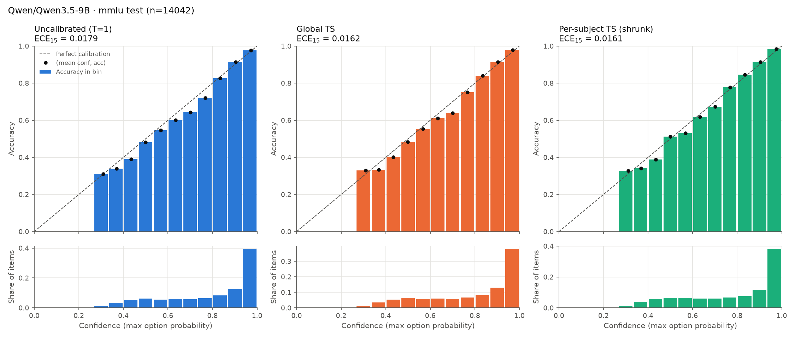
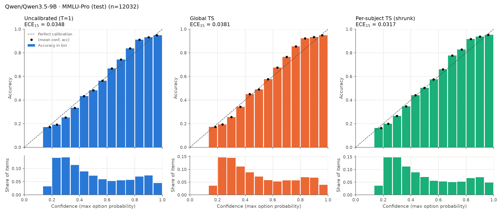
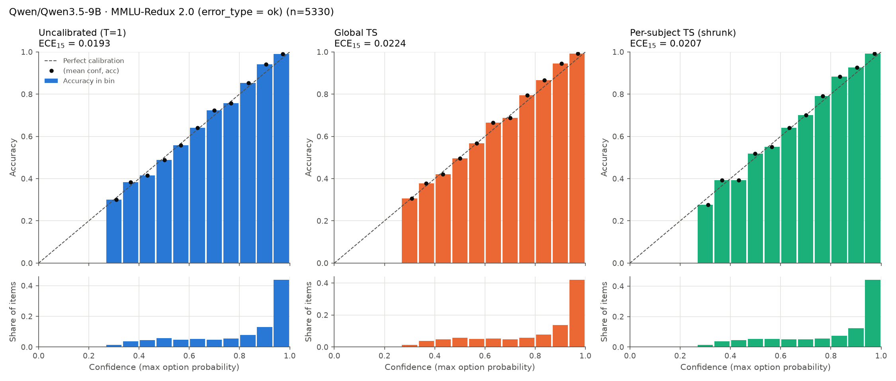
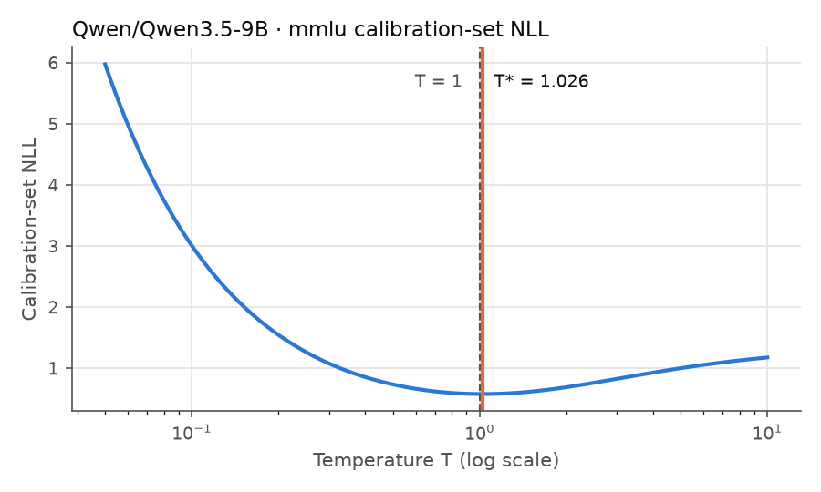

# Temperature scaling report: `Qwen/Qwen3.5-9B` on `mmlu`

- Prompt format: `plain`, letter tokens: `both` (logits of ' X' / 'X' merged with logsumexp when `both`)
- Softmax over the K option letters only (not the full vocabulary)
- Calibration split (fits every T): **1816** items; held-out test split: **14042** items; test-only `mmlu_pro`: **12032** items; test-only `mmlu_redux`: **5330** items
- ECE/MCE use equal-width confidence bins; both 15 and 10 bins reported

## Fitted temperature

**Global T = 1.0258** (grid search 0.05–10: 1.0324; LBFGS on log T: 1.0258)

T > 1 means the raw model was over-confident; T < 1 means under-confident.

Per-subject TS fits one T per subject on the calibration split, shrunk toward the global T:
`T_s = argmin NLL_s(T) + λ·(log T − log T_global)²`. λ=0 is fully independent, λ=∞ is global TS. λ chosen by subject-stratified 5-fold CV on the calibration split: **λ = 10**.

| λ | 0 | 1 | 3 | 10 | 30 | 100 | 300 | 1000 | inf |
|---|---:|---:|---:|---:|---:|---:|---:|---:|---:|
| CV NLL | 0.8081 | 0.5867 | 0.5747 | 0.5704 | 0.5715 | 0.5741 | 0.5757 | 0.5764 | 0.5768 |

## Test split

| Metric | Uncalibrated (T=1) | Global TS | Per-subject TS (independent) | Per-subject TS (shrunk) |
|---|---:|---:|---:|---:|
| Accuracy ↑ | 0.7841 | 0.7841 | 0.7841 | 0.7841 |
| ECE (15 bins) ↓ | 0.0179 | 0.0162 | 0.0168 | **0.0161** |
| ECE (10 bins) ↓ | 0.0172 | 0.0161 | **0.0127** | 0.0133 |
| MCE (15 bins) ↓ | 0.0571 | 0.0611 | **0.0368** | 0.0457 |
| NLL ↓ | 0.5711 | 0.5709 | 0.6651 | **0.5635** |
| Brier ↓ | 0.2962 | 0.2959 | 0.2970 | **0.2937** |
| Mean confidence  | 0.7952 | 0.7898 | 0.7939 | 0.7854 |

Predictions identical to uncalibrated for every method: **True** (T>0 does not change the argmax, so accuracy is unchanged by construction).

### High-confidence region

| Method | conf ≥ | share of items | accuracy | mean conf | conf − acc |
|---|---:|---:|---:|---:|---:|
| Uncalibrated (T=1) | 0.8 | 0.603 | 0.9434 | 0.9388 | -0.0046 |
| Uncalibrated (T=1) | 0.9 | 0.466 | 0.9697 | 0.9635 | -0.0062 |
| Uncalibrated (T=1) | 0.95 | 0.337 | 0.9820 | 0.9768 | -0.0052 |
| Global TS | 0.8 | 0.592 | 0.9452 | 0.9367 | -0.0085 |
| Global TS | 0.9 | 0.453 | 0.9716 | 0.9617 | -0.0098 |
| Global TS | 0.95 | 0.319 | 0.9828 | 0.9757 | -0.0071 |
| Per-subject TS (independent) | 0.8 | 0.586 | 0.9453 | 0.9515 | +0.0062 |
| Per-subject TS (independent) | 0.9 | 0.474 | 0.9644 | 0.9748 | +0.0104 |
| Per-subject TS (independent) | 0.95 | 0.384 | 0.9723 | 0.9861 | +0.0137 |
| Per-subject TS (shrunk) | 0.8 | 0.576 | 0.9519 | 0.9417 | -0.0102 |
| Per-subject TS (shrunk) | 0.9 | 0.450 | 0.9763 | 0.9664 | -0.0099 |
| Per-subject TS (shrunk) | 0.95 | 0.335 | 0.9873 | 0.9796 | -0.0076 |

### Per-subset calibration (sorted by ECE15 under Per-subject TS (shrunk))

`gap` = mean confidence − accuracy (positive: over-confident). `n_cal` = calibration items available to fit the T used here. `T` = mean per-item temperature. Per-subset ECE on ~100 items is itself noisy (small-sample ECE is biased upward).

| Subset | n | n_cal | acc | ECE none | ECE global | ECE indep | ECE shrunk | T indep | T shrunk | gap none | gap global | gap shrunk |
|---|---:|---:|---:|---:|---:|---:|---:|---:|---:|---:|---:|---:|
| virology | 166 | 23 | 0.542 | 0.3018 | 0.2949 | 0.0626 | 0.1742 | 2.915 | 1.670 | +0.2925 | +0.2871 | +0.1574 |
| college_computer_science | 100 | 16 | 0.760 | 0.1252 | 0.1101 | 0.1353 | 0.1633 | 0.781 | 0.949 | -0.0751 | -0.0809 | -0.0632 |
| jurisprudence | 108 | 16 | 0.898 | 0.0928 | 0.0884 | 0.1647 | 0.1137 | 1.515 | 1.199 | -0.0539 | -0.0588 | -0.0923 |
| public_relations | 110 | 17 | 0.727 | 0.1107 | 0.0735 | 0.1290 | 0.1111 | 1.958 | 1.339 | +0.0500 | +0.0446 | -0.0188 |
| machine_learning | 112 | 16 | 0.688 | 0.1524 | 0.1511 | 0.1470 | 0.1065 | 0.502 | 0.876 | -0.0136 | -0.0198 | +0.0178 |
| business_ethics | 100 | 16 | 0.800 | 0.0961 | 0.0937 | 0.0937 | 0.1044 | 0.657 | 0.940 | -0.0026 | -0.0077 | +0.0092 |
| abstract_algebra | 100 | 16 | 0.610 | 0.0684 | 0.0905 | 0.0990 | 0.1030 | 1.046 | 1.032 | -0.0105 | -0.0169 | -0.0183 |
| moral_disputes | 346 | 43 | 0.803 | 0.0579 | 0.0572 | 0.1135 | 0.1022 | 1.287 | 1.178 | -0.0338 | -0.0400 | -0.0757 |
| college_chemistry | 100 | 13 | 0.610 | 0.1084 | 0.1094 | 0.1160 | 0.0998 | 1.351 | 1.112 | +0.0724 | +0.0677 | +0.0524 |
| high_school_computer_science | 100 | 14 | 0.860 | 0.0941 | 0.0672 | 0.0934 | 0.0976 | 0.974 | 1.009 | -0.0497 | -0.0551 | -0.0516 |
| college_physics | 102 | 16 | 0.686 | 0.1025 | 0.0986 | 0.0993 | 0.0949 | 1.345 | 1.107 | -0.0132 | -0.0179 | -0.0323 |
| anatomy | 135 | 19 | 0.770 | 0.0877 | 0.0864 | 0.1107 | 0.0939 | 0.842 | 0.961 | +0.0590 | +0.0539 | +0.0668 |
| formal_logic | 126 | 19 | 0.698 | 0.1259 | 0.1330 | 0.1106 | 0.0935 | 0.610 | 0.912 | -0.0435 | -0.0489 | -0.0245 |
| medical_genetics | 100 | 16 | 0.900 | 0.0892 | 0.0939 | 0.0549 | 0.0910 | 0.702 | 0.974 | -0.0281 | -0.0322 | -0.0240 |
| computer_security | 100 | 16 | 0.830 | 0.1159 | 0.1126 | 0.1169 | 0.0905 | 0.599 | 0.904 | -0.0022 | -0.0069 | +0.0151 |
| high_school_chemistry | 203 | 27 | 0.764 | 0.0846 | 0.0874 | 0.0835 | 0.0847 | 0.978 | 1.005 | +0.0438 | +0.0384 | +0.0428 |
| global_facts | 100 | 15 | 0.470 | 0.0908 | 0.0848 | 0.0835 | 0.0847 | 1.041 | 1.027 | +0.0728 | +0.0673 | +0.0670 |
| astronomy | 152 | 21 | 0.941 | 0.0762 | 0.0811 | 0.0802 | 0.0802 | 0.940 | 0.996 | -0.0747 | -0.0798 | -0.0739 |
| professional_psychology | 612 | 74 | 0.832 | 0.0176 | 0.0201 | 0.1030 | 0.0758 | 1.482 | 1.345 | -0.0025 | -0.0078 | -0.0732 |
| professional_accounting | 282 | 36 | 0.656 | 0.0892 | 0.0835 | 0.0931 | 0.0749 | 0.715 | 0.872 | +0.0211 | +0.0156 | +0.0497 |
| security_studies | 245 | 32 | 0.792 | 0.0729 | 0.0735 | 0.0701 | 0.0726 | 0.978 | 1.005 | +0.0158 | +0.0104 | +0.0148 |
| professional_medicine | 272 | 36 | 0.871 | 0.0706 | 0.0735 | 0.0713 | 0.0723 | 1.009 | 1.018 | -0.0382 | -0.0433 | -0.0418 |
| philosophy | 311 | 39 | 0.781 | 0.0586 | 0.0650 | 0.0743 | 0.0721 | 1.098 | 1.064 | +0.0222 | +0.0167 | +0.0086 |
| human_aging | 223 | 28 | 0.767 | 0.0884 | 0.0755 | 0.0583 | 0.0717 | 1.183 | 1.102 | +0.0472 | +0.0414 | +0.0242 |
| moral_scenarios | 895 | 105 | 0.539 | 0.1005 | 0.0928 | 0.0563 | 0.0688 | 1.226 | 1.173 | +0.0924 | +0.0847 | +0.0451 |
| electrical_engineering | 145 | 21 | 0.821 | 0.0786 | 0.0690 | 0.0854 | 0.0681 | 0.781 | 0.944 | -0.0318 | -0.0374 | -0.0199 |
| us_foreign_policy | 100 | 16 | 0.880 | 0.0554 | 0.0570 | 0.0431 | 0.0667 | 0.831 | 0.974 | +0.0133 | +0.0090 | +0.0176 |
| human_sexuality | 131 | 17 | 0.878 | 0.0715 | 0.0699 | 0.0631 | 0.0662 | 1.032 | 1.027 | -0.0255 | -0.0304 | -0.0307 |
| college_mathematics | 100 | 16 | 0.600 | 0.0978 | 0.1262 | 0.0640 | 0.0642 | 0.778 | 0.966 | -0.0042 | -0.0101 | +0.0039 |
| high_school_statistics | 216 | 28 | 0.815 | 0.0835 | 0.0729 | 0.0667 | 0.0635 | 0.640 | 0.880 | -0.0511 | -0.0566 | -0.0252 |
| econometrics | 114 | 17 | 0.737 | 0.0854 | 0.0669 | 0.1310 | 0.0631 | 0.541 | 0.880 | +0.0174 | +0.0117 | +0.0445 |
| high_school_geography | 198 | 27 | 0.909 | 0.0644 | 0.0697 | 0.0549 | 0.0614 | 0.932 | 0.987 | -0.0062 | -0.0101 | -0.0042 |
| international_law | 121 | 18 | 0.893 | 0.0707 | 0.0691 | 0.0475 | 0.0587 | 0.566 | 0.888 | -0.0289 | -0.0340 | -0.0073 |
| high_school_mathematics | 270 | 34 | 0.574 | 0.0646 | 0.0579 | 0.0721 | 0.0578 | 0.791 | 0.920 | -0.0260 | -0.0311 | -0.0089 |
| high_school_us_history | 204 | 27 | 0.917 | 0.0569 | 0.0646 | 0.0602 | 0.0576 | 0.983 | 1.005 | -0.0454 | -0.0506 | -0.0464 |
| marketing | 234 | 30 | 0.940 | 0.0607 | 0.0616 | 0.0455 | 0.0575 | 0.771 | 0.916 | -0.0462 | -0.0507 | -0.0319 |
| nutrition | 306 | 38 | 0.876 | 0.0478 | 0.0526 | 0.0460 | 0.0550 | 0.996 | 1.014 | -0.0203 | -0.0250 | -0.0228 |
| management | 103 | 16 | 0.883 | 0.0783 | 0.0687 | 0.1141 | 0.0549 | 0.050 | 0.916 | -0.0150 | -0.0201 | +0.0014 |
| conceptual_physics | 235 | 31 | 0.915 | 0.0542 | 0.0592 | 0.0515 | 0.0535 | 0.961 | 0.996 | -0.0529 | -0.0580 | -0.0521 |
| elementary_mathematics | 378 | 46 | 0.733 | 0.0483 | 0.0555 | 0.0566 | 0.0526 | 1.046 | 1.036 | -0.0046 | -0.0105 | -0.0128 |
| high_school_european_history | 165 | 23 | 0.879 | 0.0536 | 0.0495 | 0.0680 | 0.0517 | 1.183 | 1.093 | +0.0099 | +0.0049 | -0.0083 |
| clinical_knowledge | 265 | 34 | 0.853 | 0.0400 | 0.0392 | 0.0812 | 0.0490 | 0.581 | 0.838 | +0.0137 | +0.0090 | +0.0421 |
| high_school_biology | 310 | 37 | 0.939 | 0.0497 | 0.0494 | 0.0393 | 0.0484 | 0.949 | 0.987 | -0.0255 | -0.0298 | -0.0235 |
| high_school_physics | 151 | 22 | 0.775 | 0.0372 | 0.0535 | 0.0885 | 0.0479 | 0.681 | 0.900 | -0.0359 | -0.0416 | -0.0134 |
| professional_law | 1534 | 175 | 0.602 | 0.0925 | 0.0854 | 0.0384 | 0.0465 | 1.270 | 1.226 | +0.0920 | +0.0853 | +0.0369 |
| high_school_government_and_politics | 193 | 26 | 0.959 | 0.0498 | 0.0607 | 0.0345 | 0.0462 | 0.731 | 0.944 | -0.0303 | -0.0339 | -0.0227 |
| world_religions | 171 | 24 | 0.877 | 0.0481 | 0.0457 | 0.0423 | 0.0456 | 1.041 | 1.032 | +0.0111 | +0.0069 | +0.0059 |
| college_medicine | 173 | 27 | 0.792 | 0.0467 | 0.0463 | 0.0670 | 0.0437 | 0.802 | 0.936 | +0.0240 | +0.0185 | +0.0374 |
| sociology | 201 | 27 | 0.905 | 0.0547 | 0.0530 | 0.0970 | 0.0425 | 0.050 | 0.824 | -0.0167 | -0.0213 | +0.0121 |
| college_biology | 144 | 21 | 0.944 | 0.0464 | 0.0517 | 0.0534 | 0.0425 | 0.050 | 0.865 | -0.0349 | -0.0391 | -0.0144 |
| high_school_macroeconomics | 390 | 48 | 0.841 | 0.0490 | 0.0516 | 0.0355 | 0.0412 | 0.857 | 0.936 | -0.0009 | -0.0057 | +0.0110 |
| high_school_world_history | 237 | 31 | 0.895 | 0.0407 | 0.0368 | 0.0470 | 0.0392 | 0.728 | 0.904 | -0.0021 | -0.0065 | +0.0140 |
| prehistory | 324 | 40 | 0.858 | 0.0376 | 0.0430 | 0.0498 | 0.0367 | 1.078 | 1.055 | -0.0068 | -0.0114 | -0.0166 |
| logical_fallacies | 163 | 23 | 0.877 | 0.0568 | 0.0557 | 0.0795 | 0.0348 | 0.728 | 0.932 | -0.0087 | -0.0136 | +0.0037 |
| high_school_microeconomics | 238 | 31 | 0.937 | 0.0592 | 0.0667 | 0.0599 | 0.0338 | 0.050 | 0.835 | -0.0453 | -0.0496 | -0.0196 |
| miscellaneous | 783 | 91 | 0.885 | 0.0280 | 0.0307 | 0.0265 | 0.0243 | 0.846 | 0.908 | +0.0026 | -0.0015 | +0.0170 |
| high_school_psychology | 545 | 65 | 0.936 | 0.0306 | 0.0333 | 0.0322 | 0.0177 | 0.684 | 0.842 | -0.0290 | -0.0333 | -0.0042 |

## Test-only: MMLU-Pro (test)

Temperatures are the ones fitted on the calibration split above; nothing is fitted on this set. 56.6% of items have a subject with a fitted per-subject T; the rest use the global T.

| Metric | Uncalibrated (T=1) | Global TS | Per-subject TS (independent) | Per-subject TS (shrunk) |
|---|---:|---:|---:|---:|
| Accuracy ↑ | 0.5104 | 0.5104 | 0.5104 | 0.5104 |
| ECE (15 bins) ↓ | 0.0348 | 0.0381 | **0.0269** | 0.0317 |
| ECE (10 bins) ↓ | 0.0336 | 0.0359 | **0.0285** | 0.0310 |
| MCE (15 bins) ↓ | **0.0764** | 0.0881 | 0.0926 | 0.0817 |
| NLL ↓ | 1.4556 | 1.4554 | 1.6812 | **1.4554** |
| Brier ↓ | **0.6091** | 0.6093 | 0.6176 | 0.6096 |
| Mean confidence  | 0.5133 | 0.5053 | 0.5236 | 0.5060 |

Predictions identical to uncalibrated for every method: **True** (T>0 does not change the argmax, so accuracy is unchanged by construction).

### High-confidence region

| Method | conf ≥ | share of items | accuracy | mean conf | conf − acc |
|---|---:|---:|---:|---:|---:|
| Uncalibrated (T=1) | 0.8 | 0.188 | 0.9280 | 0.8898 | -0.0382 |
| Uncalibrated (T=1) | 0.9 | 0.081 | 0.9476 | 0.9403 | -0.0073 |
| Uncalibrated (T=1) | 0.95 | 0.030 | 0.9530 | 0.9686 | +0.0155 |
| Global TS | 0.8 | 0.176 | 0.9326 | 0.8867 | -0.0459 |
| Global TS | 0.9 | 0.071 | 0.9485 | 0.9395 | -0.0091 |
| Global TS | 0.95 | 0.025 | 0.9500 | 0.9683 | +0.0183 |
| Per-subject TS (independent) | 0.8 | 0.220 | 0.8839 | 0.9141 | +0.0303 |
| Per-subject TS (independent) | 0.9 | 0.127 | 0.8869 | 0.9599 | +0.0731 |
| Per-subject TS (independent) | 0.95 | 0.077 | 0.8708 | 0.9822 | +0.1114 |
| Per-subject TS (shrunk) | 0.8 | 0.185 | 0.9335 | 0.8924 | -0.0411 |
| Per-subject TS (shrunk) | 0.9 | 0.084 | 0.9458 | 0.9416 | -0.0042 |
| Per-subject TS (shrunk) | 0.95 | 0.032 | 0.9633 | 0.9700 | +0.0068 |

### Per-category calibration (sorted by ECE15 under Per-subject TS (shrunk))

`gap` = mean confidence − accuracy (positive: over-confident). `n_cal` = calibration items available to fit the T used here. `T` = mean per-item temperature. Per-subset ECE on ~100 items is itself noisy (small-sample ECE is biased upward).

| Category | n | n_cal | acc | ECE none | ECE global | ECE indep | ECE shrunk | T indep | T shrunk | gap none | gap global | gap shrunk |
|---|---:|---:|---:|---:|---:|---:|---:|---:|---:|---:|---:|---:|
| biology | 717 | 58 | 0.823 | 0.1141 | 0.1236 | 0.1301 | 0.1128 | 0.903 | 1.000 | -0.0966 | -0.1059 | -0.0970 |
| psychology | 798 | 139 | 0.736 | 0.0622 | 0.0686 | 0.0979 | 0.0908 | 1.139 | 1.116 | -0.0473 | -0.0572 | -0.0847 |
| other | 924 | 304 | 0.550 | 0.0582 | 0.0505 | 0.0941 | 0.0755 | 0.876 | 0.956 | +0.0364 | +0.0279 | +0.0536 |
| business | 789 | 62 | 0.352 | 0.0790 | 0.0730 | 0.0960 | 0.0738 | 0.936 | 1.005 | +0.0593 | +0.0518 | +0.0595 |
| computer science | 410 | 62 | 0.563 | 0.0668 | 0.0850 | 0.0731 | 0.0711 | 0.810 | 0.962 | -0.0466 | -0.0549 | -0.0339 |
| math | 1351 | 140 | 0.380 | 0.0721 | 0.0636 | 0.0605 | 0.0594 | 0.935 | 0.991 | +0.0299 | +0.0226 | +0.0335 |
| engineering | 969 | 21 | 0.372 | 0.0497 | 0.0534 | 0.0486 | 0.0533 | 1.009 | 1.020 | -0.0091 | -0.0156 | -0.0137 |
| economics | 844 | 96 | 0.678 | 0.0615 | 0.0657 | 0.0819 | 0.0531 | 0.768 | 0.956 | -0.0287 | -0.0380 | -0.0111 |
| history | 381 | 121 | 0.627 | 0.0573 | 0.0518 | 0.0592 | 0.0472 | 0.999 | 1.017 | -0.0218 | -0.0313 | -0.0274 |
| philosophy | 499 | 148 | 0.599 | 0.0578 | 0.0678 | 0.0562 | 0.0442 | 0.994 | 1.043 | +0.0092 | +0.0002 | -0.0048 |
| physics | 1299 | 90 | 0.406 | 0.0497 | 0.0457 | 0.0390 | 0.0434 | 0.997 | 1.013 | -0.0004 | -0.0074 | -0.0021 |
| chemistry | 1132 | 40 | 0.353 | 0.0465 | 0.0437 | 0.0406 | 0.0432 | 1.039 | 1.028 | +0.0247 | +0.0181 | +0.0175 |
| law | 1101 | 209 | 0.442 | 0.0521 | 0.0484 | 0.0401 | 0.0348 | 1.244 | 1.208 | +0.0521 | +0.0434 | -0.0096 |
| health | 818 | 221 | 0.672 | 0.0388 | 0.0458 | 0.0405 | 0.0330 | 1.045 | 1.034 | -0.0088 | -0.0177 | -0.0183 |

## Test-only: MMLU-Redux 2.0 (error_type = ok)

Temperatures are the ones fitted on the calibration split above; nothing is fitted on this set. 100.0% of items have a subject with a fitted per-subject T; the rest use the global T.

| Metric | Uncalibrated (T=1) | Global TS | Per-subject TS (independent) | Per-subject TS (shrunk) |
|---|---:|---:|---:|---:|
| Accuracy ↑ | 0.8229 | 0.8229 | 0.8229 | 0.8229 |
| ECE (15 bins) ↓ | 0.0193 | 0.0224 | **0.0148** | 0.0207 |
| ECE (10 bins) ↓ | 0.0187 | 0.0217 | **0.0101** | 0.0175 |
| MCE (15 bins) ↓ | 0.0369 | 0.0405 | **0.0330** | 0.0475 |
| NLL ↓ | **0.4662** | 0.4677 | 0.6273 | 0.4668 |
| Brier ↓ | **0.2420** | 0.2422 | 0.2495 | 0.2422 |
| Mean confidence  | 0.8087 | 0.8037 | 0.8257 | 0.8087 |

Predictions identical to uncalibrated for every method: **True** (T>0 does not change the argmax, so accuracy is unchanged by construction).

### High-confidence region

| Method | conf ≥ | share of items | accuracy | mean conf | conf − acc |
|---|---:|---:|---:|---:|---:|
| Uncalibrated (T=1) | 0.8 | 0.645 | 0.9645 | 0.9419 | -0.0226 |
| Uncalibrated (T=1) | 0.9 | 0.517 | 0.9859 | 0.9635 | -0.0223 |
| Uncalibrated (T=1) | 0.95 | 0.372 | 0.9934 | 0.9771 | -0.0163 |
| Global TS | 0.8 | 0.634 | 0.9669 | 0.9399 | -0.0269 |
| Global TS | 0.9 | 0.503 | 0.9870 | 0.9618 | -0.0252 |
| Global TS | 0.95 | 0.353 | 0.9942 | 0.9759 | -0.0183 |
| Per-subject TS (independent) | 0.8 | 0.661 | 0.9512 | 0.9568 | +0.0056 |
| Per-subject TS (independent) | 0.9 | 0.557 | 0.9653 | 0.9760 | +0.0107 |
| Per-subject TS (independent) | 0.95 | 0.456 | 0.9724 | 0.9867 | +0.0143 |
| Per-subject TS (shrunk) | 0.8 | 0.639 | 0.9662 | 0.9447 | -0.0215 |
| Per-subject TS (shrunk) | 0.9 | 0.516 | 0.9836 | 0.9660 | -0.0176 |
| Per-subject TS (shrunk) | 0.95 | 0.383 | 0.9926 | 0.9791 | -0.0135 |

### Per-subset calibration (sorted by ECE15 under Per-subject TS (shrunk))

`gap` = mean confidence − accuracy (positive: over-confident). `n_cal` = calibration items available to fit the T used here. `T` = mean per-item temperature. Per-subset ECE on ~100 items is itself noisy (small-sample ECE is biased upward).

| Subset | n | n_cal | acc | ECE none | ECE global | ECE indep | ECE shrunk | T indep | T shrunk | gap none | gap global | gap shrunk |
|---|---:|---:|---:|---:|---:|---:|---:|---:|---:|---:|---:|---:|
| college_computer_science | 97 | 16 | 0.773 | 0.1445 | 0.1212 | 0.1345 | 0.1450 | 0.781 | 0.949 | -0.0851 | -0.0909 | -0.0732 |
| professional_law | 82 | 175 | 0.549 | 0.1605 | 0.1595 | 0.1024 | 0.1385 | 1.270 | 1.226 | +0.1439 | +0.1376 | +0.0918 |
| professional_psychology | 96 | 74 | 0.854 | 0.0792 | 0.0816 | 0.1448 | 0.1313 | 1.482 | 1.345 | -0.0178 | -0.0232 | -0.0900 |
| professional_accounting | 92 | 36 | 0.663 | 0.0848 | 0.0942 | 0.1156 | 0.1311 | 0.715 | 0.872 | +0.0082 | +0.0028 | +0.0360 |
| virology | 43 | 23 | 0.837 | 0.1395 | 0.1461 | 0.2992 | 0.1277 | 2.915 | 1.670 | +0.0176 | +0.0127 | -0.1109 |
| machine_learning | 89 | 16 | 0.697 | 0.1693 | 0.1512 | 0.1580 | 0.1254 | 0.502 | 0.876 | -0.0222 | -0.0283 | +0.0084 |
| formal_logic | 87 | 19 | 0.713 | 0.1337 | 0.1281 | 0.1358 | 0.1229 | 0.610 | 0.912 | -0.0491 | -0.0546 | -0.0298 |
| anatomy | 99 | 19 | 0.758 | 0.1123 | 0.1238 | 0.1536 | 0.1225 | 0.842 | 0.961 | +0.0606 | +0.0554 | +0.0682 |
| abstract_algebra | 89 | 16 | 0.618 | 0.0917 | 0.1061 | 0.1118 | 0.1199 | 1.046 | 1.032 | -0.0310 | -0.0370 | -0.0384 |
| moral_disputes | 96 | 43 | 0.865 | 0.0899 | 0.0954 | 0.1554 | 0.1185 | 1.287 | 1.178 | -0.0680 | -0.0741 | -0.1098 |
| elementary_mathematics | 97 | 46 | 0.753 | 0.0846 | 0.1006 | 0.1179 | 0.1176 | 1.046 | 1.036 | -0.0169 | -0.0226 | -0.0249 |
| computer_security | 97 | 16 | 0.835 | 0.1334 | 0.1301 | 0.1344 | 0.1139 | 0.599 | 0.904 | -0.0123 | -0.0170 | +0.0051 |
| jurisprudence | 99 | 16 | 0.889 | 0.0948 | 0.0875 | 0.1587 | 0.1136 | 1.515 | 1.199 | -0.0449 | -0.0500 | -0.0842 |
| professional_medicine | 99 | 36 | 0.909 | 0.1076 | 0.1117 | 0.1091 | 0.1105 | 1.009 | 1.018 | -0.0581 | -0.0630 | -0.0615 |
| high_school_mathematics | 100 | 34 | 0.620 | 0.1115 | 0.1140 | 0.0862 | 0.1089 | 0.791 | 0.920 | -0.0772 | -0.0823 | -0.0602 |
| public_relations | 91 | 17 | 0.780 | 0.0766 | 0.0539 | 0.1733 | 0.1074 | 1.958 | 1.339 | +0.0252 | +0.0199 | -0.0446 |
| astronomy | 94 | 21 | 0.947 | 0.1059 | 0.1097 | 0.1073 | 0.1053 | 0.940 | 0.996 | -0.0840 | -0.0890 | -0.0832 |
| college_chemistry | 75 | 13 | 0.733 | 0.1176 | 0.0972 | 0.0976 | 0.1027 | 1.351 | 1.112 | +0.0143 | +0.0095 | -0.0061 |
| high_school_statistics | 98 | 28 | 0.806 | 0.1074 | 0.1154 | 0.0667 | 0.1019 | 0.640 | 0.880 | -0.0447 | -0.0502 | -0.0187 |
| human_aging | 87 | 28 | 0.805 | 0.1430 | 0.1230 | 0.1030 | 0.1011 | 1.183 | 1.102 | +0.0286 | +0.0230 | +0.0064 |
| medical_genetics | 100 | 16 | 0.910 | 0.0992 | 0.0972 | 0.0577 | 0.1009 | 0.702 | 0.974 | -0.0380 | -0.0421 | -0.0339 |
| high_school_us_history | 100 | 27 | 0.920 | 0.0924 | 0.0904 | 0.0927 | 0.0929 | 0.983 | 1.005 | -0.0631 | -0.0681 | -0.0640 |
| global_facts | 88 | 15 | 0.466 | 0.0977 | 0.0904 | 0.0886 | 0.0902 | 1.041 | 1.027 | +0.0805 | +0.0750 | +0.0747 |
| college_physics | 100 | 16 | 0.680 | 0.1073 | 0.0896 | 0.0841 | 0.0901 | 1.345 | 1.107 | -0.0018 | -0.0066 | -0.0211 |
| moral_scenarios | 97 | 105 | 0.577 | 0.1215 | 0.0893 | 0.0770 | 0.0898 | 1.226 | 1.173 | +0.0495 | +0.0418 | +0.0018 |
| electrical_engineering | 98 | 21 | 0.816 | 0.0892 | 0.0859 | 0.0810 | 0.0889 | 0.781 | 0.944 | -0.0266 | -0.0323 | -0.0144 |
| world_religions | 99 | 24 | 0.919 | 0.0933 | 0.0879 | 0.0689 | 0.0878 | 1.041 | 1.032 | -0.0254 | -0.0296 | -0.0306 |
| human_sexuality | 81 | 17 | 0.914 | 0.0803 | 0.0838 | 0.0843 | 0.0839 | 1.032 | 1.027 | -0.0317 | -0.0359 | -0.0362 |
| high_school_macroeconomics | 97 | 48 | 0.814 | 0.0738 | 0.0925 | 0.0588 | 0.0837 | 0.857 | 0.936 | +0.0031 | -0.0019 | +0.0154 |
| high_school_computer_science | 100 | 14 | 0.860 | 0.0862 | 0.0702 | 0.0936 | 0.0815 | 0.974 | 1.009 | -0.0493 | -0.0547 | -0.0512 |
| high_school_geography | 100 | 27 | 0.880 | 0.0917 | 0.0996 | 0.0805 | 0.0807 | 0.932 | 0.987 | +0.0154 | +0.0112 | +0.0175 |
| international_law | 95 | 18 | 0.884 | 0.0969 | 0.0955 | 0.0704 | 0.0802 | 0.566 | 0.888 | -0.0199 | -0.0250 | +0.0015 |
| security_studies | 94 | 32 | 0.745 | 0.0827 | 0.0860 | 0.0929 | 0.0798 | 0.978 | 1.005 | +0.0577 | +0.0522 | +0.0567 |
| high_school_chemistry | 99 | 27 | 0.818 | 0.0817 | 0.0720 | 0.1001 | 0.0795 | 0.978 | 1.005 | -0.0220 | -0.0274 | -0.0230 |
| college_medicine | 87 | 27 | 0.839 | 0.0787 | 0.0718 | 0.0701 | 0.0785 | 0.802 | 0.936 | +0.0039 | -0.0017 | +0.0176 |
| clinical_knowledge | 99 | 34 | 0.838 | 0.0962 | 0.0847 | 0.1214 | 0.0770 | 0.581 | 0.838 | +0.0353 | +0.0307 | +0.0625 |
| business_ethics | 85 | 16 | 0.929 | 0.0797 | 0.0805 | 0.0746 | 0.0769 | 0.657 | 0.940 | -0.0658 | -0.0712 | -0.0536 |
| us_foreign_policy | 99 | 16 | 0.889 | 0.0647 | 0.0702 | 0.0530 | 0.0762 | 0.831 | 0.974 | +0.0052 | +0.0009 | +0.0094 |
| high_school_biology | 95 | 37 | 0.958 | 0.0756 | 0.0950 | 0.0752 | 0.0756 | 0.949 | 0.987 | -0.0433 | -0.0476 | -0.0411 |
| high_school_microeconomics | 98 | 31 | 0.959 | 0.0822 | 0.0828 | 0.0404 | 0.0745 | 0.050 | 0.835 | -0.0617 | -0.0657 | -0.0379 |
| sociology | 98 | 27 | 0.898 | 0.0747 | 0.0722 | 0.1020 | 0.0724 | 0.050 | 0.824 | -0.0002 | -0.0050 | +0.0304 |
| prehistory | 100 | 40 | 0.860 | 0.0688 | 0.0616 | 0.0795 | 0.0707 | 1.078 | 1.055 | -0.0105 | -0.0149 | -0.0199 |
| philosophy | 89 | 39 | 0.831 | 0.0867 | 0.0789 | 0.0597 | 0.0673 | 1.098 | 1.064 | -0.0020 | -0.0075 | -0.0158 |
| high_school_world_history | 99 | 31 | 0.949 | 0.0706 | 0.0766 | 0.0259 | 0.0673 | 0.728 | 0.904 | -0.0388 | -0.0431 | -0.0236 |
| nutrition | 97 | 38 | 0.856 | 0.0659 | 0.0683 | 0.0627 | 0.0659 | 0.996 | 1.014 | +0.0188 | +0.0143 | +0.0165 |
| high_school_government_and_politics | 100 | 26 | 0.950 | 0.0710 | 0.0762 | 0.0528 | 0.0649 | 0.731 | 0.944 | -0.0296 | -0.0333 | -0.0220 |
| marketing | 96 | 30 | 0.969 | 0.0704 | 0.0752 | 0.0407 | 0.0621 | 0.771 | 0.916 | -0.0539 | -0.0582 | -0.0405 |
| college_biology | 98 | 21 | 0.929 | 0.0508 | 0.0544 | 0.0684 | 0.0616 | 0.050 | 0.865 | -0.0333 | -0.0375 | -0.0125 |
| econometrics | 97 | 17 | 0.763 | 0.0459 | 0.0455 | 0.1370 | 0.0600 | 0.541 | 0.880 | +0.0113 | +0.0054 | +0.0388 |
| high_school_european_history | 91 | 23 | 0.912 | 0.0614 | 0.0545 | 0.0734 | 0.0595 | 1.183 | 1.093 | -0.0151 | -0.0200 | -0.0330 |
| conceptual_physics | 92 | 31 | 0.902 | 0.0576 | 0.0670 | 0.0691 | 0.0570 | 0.961 | 0.996 | -0.0318 | -0.0369 | -0.0310 |
| college_mathematics | 99 | 16 | 0.596 | 0.1052 | 0.1060 | 0.0890 | 0.0568 | 0.778 | 0.966 | -0.0001 | -0.0060 | +0.0080 |
| high_school_physics | 97 | 22 | 0.763 | 0.0858 | 0.0742 | 0.0823 | 0.0562 | 0.681 | 0.900 | -0.0156 | -0.0213 | +0.0071 |
| management | 99 | 16 | 0.879 | 0.0867 | 0.0683 | 0.1189 | 0.0513 | 0.050 | 0.916 | -0.0082 | -0.0132 | +0.0079 |
| miscellaneous | 90 | 91 | 0.900 | 0.0509 | 0.0619 | 0.0524 | 0.0506 | 0.846 | 0.908 | +0.0122 | +0.0081 | +0.0264 |
| logical_fallacies | 74 | 23 | 0.932 | 0.0633 | 0.0809 | 0.0428 | 0.0459 | 0.728 | 0.932 | -0.0285 | -0.0325 | -0.0182 |
| high_school_psychology | 96 | 65 | 0.927 | 0.0586 | 0.0621 | 0.0454 | 0.0421 | 0.684 | 0.842 | -0.0166 | -0.0212 | +0.0092 |

## Calibration split metrics (in-sample for every fitted method)

| Metric | Uncalibrated (T=1) | Global TS | Per-subject TS (independent) | Per-subject TS (shrunk) |
|---|---:|---:|---:|---:|
| Accuracy ↑ | 0.7786 | 0.7786 | 0.7786 | 0.7786 |
| ECE (15 bins) ↓ | 0.0250 | 0.0268 | **0.0192** | 0.0237 |
| ECE (10 bins) ↓ | 0.0273 | 0.0256 | **0.0196** | 0.0208 |
| MCE (15 bins) ↓ | 0.0936 | **0.0934** | 0.1051 | 0.1031 |
| NLL ↓ | 0.5768 | 0.5766 | **0.5479** | 0.5588 |
| Brier ↓ | 0.3004 | 0.3003 | **0.2921** | 0.2951 |
| Mean confidence  | 0.7896 | 0.7844 | 0.7893 | 0.7809 |

## NLL vs T on the calibration split

