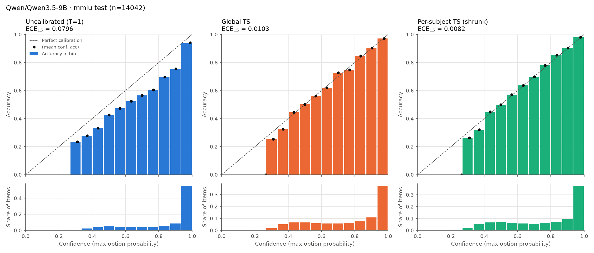
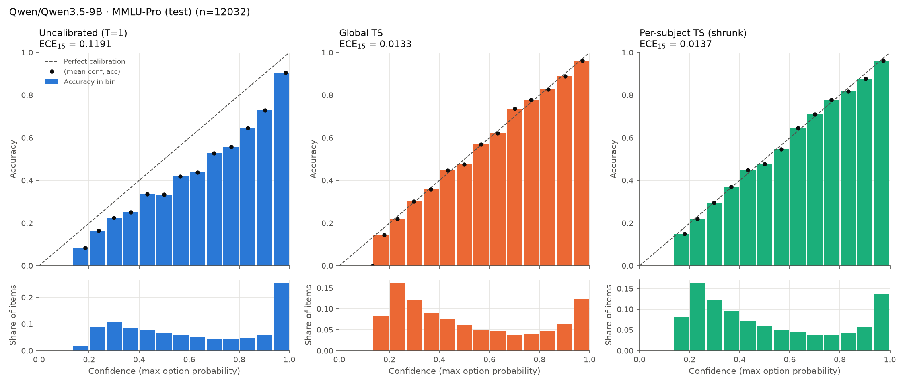
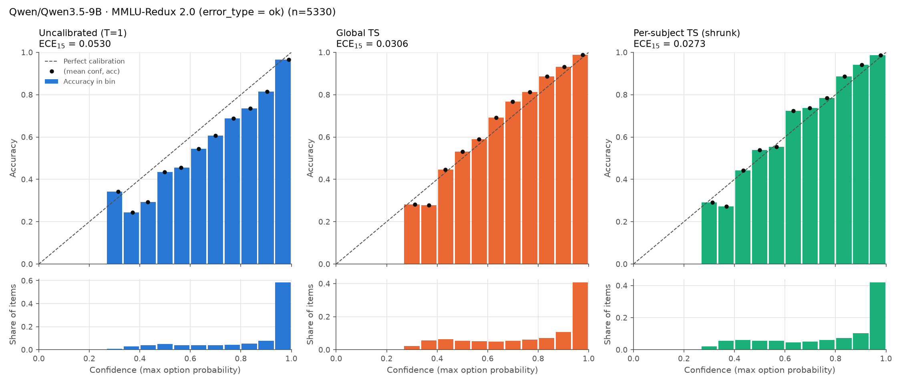
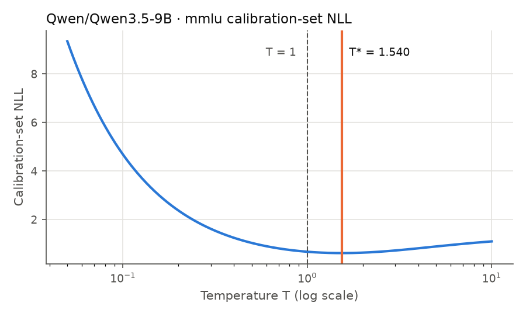

# Temperature scaling report: `Qwen/Qwen3.5-9B` on `mmlu`

- Prompt format: `quyet-v1`, letter tokens: `both` (logits of ' X' / 'X' merged with logsumexp when `both`)
- Softmax over the K option letters only (not the full vocabulary)
- Calibration split (fits every T): **1816** items; held-out test split: **14042** items; test-only `mmlu_pro`: **12032** items; test-only `mmlu_redux`: **5330** items
- ECE/MCE use equal-width confidence bins; both 15 and 10 bins reported

## Fitted temperature

**Global T = 1.5404** (grid search 0.05–10: 1.5376; LBFGS on log T: 1.5404)

T > 1 means the raw model was over-confident; T < 1 means under-confident.

Per-subject TS fits one T per subject on the calibration split, shrunk toward the global T:
`T_s = argmin NLL_s(T) + λ·(log T − log T_global)²`. λ=0 is fully independent, λ=∞ is global TS. λ chosen by subject-stratified 5-fold CV on the calibration split: **λ = 10**.

| λ | 0 | 1 | 3 | 10 | 30 | 100 | 300 | 1000 | inf |
|---|---:|---:|---:|---:|---:|---:|---:|---:|---:|
| CV NLL | 0.7534 | 0.6228 | 0.6147 | 0.6121 | 0.6136 | 0.6162 | 0.6179 | 0.6187 | 0.6191 |

## Test split

| Metric | Uncalibrated (T=1) | Global TS | Per-subject TS (independent) | Per-subject TS (shrunk) |
|---|---:|---:|---:|---:|
| Accuracy ↑ | 0.7682 | 0.7682 | 0.7682 | 0.7682 |
| ECE (15 bins) ↓ | 0.0796 | 0.0103 | 0.0145 | **0.0082** |
| ECE (10 bins) ↓ | 0.0796 | **0.0065** | 0.0134 | 0.0088 |
| MCE (15 bins) ↓ | **0.1640** | 0.2658 | 0.2647 | 0.2646 |
| NLL ↓ | 0.6653 | 0.6101 | 0.7720 | **0.5999** |
| Brier ↓ | 0.3270 | 0.3150 | 0.3160 | **0.3118** |
| Mean confidence  | 0.8478 | 0.7717 | 0.7777 | 0.7677 |

Predictions identical to uncalibrated for every method: **True** (T>0 does not change the argmax, so accuracy is unchanged by construction).

### High-confidence region

| Method | conf ≥ | share of items | accuracy | mean conf | conf − acc |
|---|---:|---:|---:|---:|---:|
| Uncalibrated (T=1) | 0.8 | 0.695 | 0.8994 | 0.9654 | +0.0660 |
| Uncalibrated (T=1) | 0.9 | 0.602 | 0.9279 | 0.9825 | +0.0546 |
| Uncalibrated (T=1) | 0.95 | 0.523 | 0.9501 | 0.9908 | +0.0407 |
| Global TS | 0.8 | 0.557 | 0.9418 | 0.9422 | +0.0004 |
| Global TS | 0.9 | 0.435 | 0.9653 | 0.9671 | +0.0018 |
| Global TS | 0.95 | 0.326 | 0.9779 | 0.9803 | +0.0024 |
| Per-subject TS (independent) | 0.8 | 0.559 | 0.9399 | 0.9543 | +0.0144 |
| Per-subject TS (independent) | 0.9 | 0.456 | 0.9608 | 0.9772 | +0.0164 |
| Per-subject TS (independent) | 0.95 | 0.375 | 0.9688 | 0.9880 | +0.0192 |
| Per-subject TS (shrunk) | 0.8 | 0.545 | 0.9498 | 0.9464 | -0.0035 |
| Per-subject TS (shrunk) | 0.9 | 0.430 | 0.9733 | 0.9713 | -0.0020 |
| Per-subject TS (shrunk) | 0.95 | 0.337 | 0.9822 | 0.9833 | +0.0010 |

### Per-subset calibration (sorted by ECE15 under Per-subject TS (shrunk))

`gap` = mean confidence − accuracy (positive: over-confident). `n_cal` = calibration items available to fit the T used here. `T` = mean per-item temperature. Per-subset ECE on ~100 items is itself noisy (small-sample ECE is biased upward).

| Subset | n | n_cal | acc | ECE none | ECE global | ECE indep | ECE shrunk | T indep | T shrunk | gap none | gap global | gap shrunk |
|---|---:|---:|---:|---:|---:|---:|---:|---:|---:|---:|---:|---:|
| college_mathematics | 100 | 16 | 0.560 | 0.1527 | 0.1881 | 0.1799 | 0.1882 | 1.536 | 1.542 | +0.1047 | +0.0014 | +0.0011 |
| global_facts | 100 | 15 | 0.370 | 0.2605 | 0.1766 | 0.1756 | 0.1764 | 1.549 | 1.542 | +0.2528 | +0.1532 | +0.1529 |
| virology | 166 | 23 | 0.524 | 0.3535 | 0.2798 | 0.0981 | 0.1722 | 3.509 | 2.246 | +0.3368 | +0.2561 | +0.1599 |
| abstract_algebra | 100 | 16 | 0.560 | 0.1335 | 0.1189 | 0.1004 | 0.1230 | 1.495 | 1.529 | +0.1090 | +0.0055 | +0.0073 |
| college_chemistry | 100 | 13 | 0.540 | 0.1709 | 0.1317 | 0.1079 | 0.1200 | 2.120 | 1.692 | +0.1709 | +0.1064 | +0.0905 |
| econometrics | 114 | 17 | 0.711 | 0.1410 | 0.1027 | 0.1982 | 0.1156 | 0.684 | 1.270 | +0.1115 | +0.0201 | +0.0646 |
| anatomy | 135 | 19 | 0.800 | 0.1480 | 0.0785 | 0.1130 | 0.1019 | 1.357 | 1.476 | +0.0922 | +0.0202 | +0.0287 |
| college_physics | 102 | 16 | 0.637 | 0.0896 | 0.0961 | 0.1431 | 0.0987 | 1.777 | 1.605 | +0.0677 | -0.0032 | -0.0106 |
| astronomy | 152 | 21 | 0.901 | 0.0345 | 0.1018 | 0.0860 | 0.0952 | 1.502 | 1.529 | -0.0003 | -0.0660 | -0.0646 |
| high_school_computer_science | 100 | 14 | 0.850 | 0.0855 | 0.0958 | 0.1054 | 0.0939 | 1.634 | 1.570 | +0.0305 | -0.0373 | -0.0410 |
| college_computer_science | 100 | 16 | 0.710 | 0.0797 | 0.0825 | 0.0971 | 0.0914 | 0.754 | 1.333 | +0.0400 | -0.0468 | -0.0160 |
| electrical_engineering | 145 | 21 | 0.772 | 0.0659 | 0.0824 | 0.0862 | 0.0904 | 1.648 | 1.577 | +0.0454 | -0.0436 | -0.0493 |
| moral_disputes | 346 | 43 | 0.757 | 0.0953 | 0.0734 | 0.1086 | 0.0854 | 2.158 | 1.873 | +0.0950 | +0.0027 | -0.0492 |
| jurisprudence | 108 | 16 | 0.870 | 0.0816 | 0.0838 | 0.1316 | 0.0840 | 2.056 | 1.707 | +0.0156 | -0.0552 | -0.0781 |
| public_relations | 110 | 17 | 0.709 | 0.1344 | 0.0962 | 0.1414 | 0.0813 | 2.966 | 1.993 | +0.1230 | +0.0364 | -0.0281 |
| computer_security | 100 | 16 | 0.790 | 0.0776 | 0.0852 | 0.0827 | 0.0806 | 0.865 | 1.351 | +0.0558 | -0.0130 | +0.0114 |
| business_ethics | 100 | 16 | 0.790 | 0.0837 | 0.1141 | 0.0706 | 0.0801 | 1.357 | 1.489 | +0.0602 | -0.0129 | -0.0058 |
| professional_medicine | 272 | 36 | 0.875 | 0.0470 | 0.0779 | 0.0780 | 0.0780 | 1.542 | 1.542 | +0.0133 | -0.0556 | -0.0558 |
| international_law | 121 | 18 | 0.876 | 0.0869 | 0.0990 | 0.0724 | 0.0767 | 1.093 | 1.412 | +0.0410 | -0.0175 | -0.0026 |
| high_school_chemistry | 203 | 27 | 0.759 | 0.0948 | 0.0880 | 0.0788 | 0.0758 | 1.162 | 1.393 | +0.0948 | +0.0176 | +0.0380 |
| machine_learning | 112 | 16 | 0.714 | 0.1483 | 0.1143 | 0.1164 | 0.0750 | 1.321 | 1.469 | +0.0384 | -0.0545 | -0.0435 |
| high_school_us_history | 204 | 27 | 0.922 | 0.0523 | 0.0441 | 0.1084 | 0.0748 | 2.139 | 1.816 | +0.0180 | -0.0364 | -0.0669 |
| medical_genetics | 100 | 16 | 0.830 | 0.0687 | 0.0770 | 0.1001 | 0.0747 | 0.816 | 1.463 | +0.0687 | +0.0133 | +0.0217 |
| formal_logic | 126 | 19 | 0.675 | 0.1043 | 0.0748 | 0.0785 | 0.0744 | 2.029 | 1.663 | +0.0811 | +0.0015 | -0.0142 |
| high_school_geography | 198 | 27 | 0.909 | 0.0428 | 0.0955 | 0.0514 | 0.0735 | 1.027 | 1.351 | +0.0006 | -0.0625 | -0.0392 |
| management | 103 | 16 | 0.864 | 0.0776 | 0.0748 | 0.1329 | 0.0730 | 0.050 | 1.327 | +0.0451 | -0.0162 | +0.0092 |
| human_sexuality | 131 | 17 | 0.832 | 0.0624 | 0.0531 | 0.0427 | 0.0682 | 1.316 | 1.469 | +0.0465 | -0.0272 | -0.0172 |
| marketing | 234 | 30 | 0.940 | 0.0408 | 0.0825 | 0.0717 | 0.0677 | 1.333 | 1.444 | -0.0169 | -0.0797 | -0.0676 |
| high_school_statistics | 216 | 28 | 0.782 | 0.0600 | 0.0677 | 0.0650 | 0.0670 | 1.381 | 1.469 | +0.0343 | -0.0454 | -0.0354 |
| clinical_knowledge | 265 | 34 | 0.849 | 0.0756 | 0.0558 | 0.0540 | 0.0650 | 1.226 | 1.387 | +0.0443 | -0.0195 | -0.0009 |
| nutrition | 306 | 38 | 0.856 | 0.0519 | 0.0571 | 0.0770 | 0.0639 | 1.761 | 1.648 | +0.0297 | -0.0380 | -0.0520 |
| logical_fallacies | 163 | 23 | 0.834 | 0.0739 | 0.0424 | 0.0471 | 0.0633 | 1.670 | 1.591 | +0.0516 | -0.0160 | -0.0224 |
| moral_scenarios | 895 | 105 | 0.555 | 0.2324 | 0.1277 | 0.0453 | 0.0620 | 2.158 | 1.984 | +0.2324 | +0.1276 | +0.0578 |
| prehistory | 324 | 40 | 0.843 | 0.0792 | 0.0649 | 0.0482 | 0.0618 | 1.437 | 1.489 | +0.0538 | -0.0178 | -0.0108 |
| high_school_world_history | 237 | 31 | 0.899 | 0.0629 | 0.0655 | 0.0652 | 0.0615 | 1.023 | 1.339 | +0.0487 | +0.0015 | +0.0208 |
| high_school_government_and_politics | 193 | 26 | 0.927 | 0.0332 | 0.0706 | 0.0521 | 0.0614 | 1.357 | 1.469 | +0.0183 | -0.0326 | -0.0250 |
| high_school_physics | 151 | 22 | 0.715 | 0.1060 | 0.0801 | 0.0818 | 0.0600 | 1.253 | 1.431 | +0.0668 | -0.0177 | -0.0015 |
| conceptual_physics | 235 | 31 | 0.851 | 0.0509 | 0.0575 | 0.0644 | 0.0578 | 1.549 | 1.542 | +0.0363 | -0.0400 | -0.0403 |
| elementary_mathematics | 378 | 46 | 0.672 | 0.0831 | 0.0491 | 0.0573 | 0.0577 | 1.194 | 1.333 | +0.0828 | -0.0098 | +0.0229 |
| world_religions | 171 | 24 | 0.854 | 0.0746 | 0.0821 | 0.0809 | 0.0541 | 1.173 | 1.425 | +0.0569 | -0.0021 | +0.0111 |
| philosophy | 311 | 39 | 0.772 | 0.0850 | 0.0525 | 0.0512 | 0.0538 | 1.634 | 1.591 | +0.0808 | -0.0026 | -0.0101 |
| security_studies | 245 | 32 | 0.812 | 0.0659 | 0.0564 | 0.0435 | 0.0526 | 1.287 | 1.425 | +0.0578 | -0.0186 | -0.0022 |
| college_medicine | 173 | 27 | 0.786 | 0.0824 | 0.0550 | 0.0634 | 0.0522 | 1.237 | 1.406 | +0.0640 | -0.0113 | +0.0071 |
| professional_accounting | 282 | 36 | 0.674 | 0.0607 | 0.0739 | 0.1272 | 0.0519 | 0.632 | 1.102 | +0.0506 | -0.0347 | +0.0327 |
| high_school_microeconomics | 238 | 31 | 0.933 | 0.0301 | 0.0885 | 0.0647 | 0.0481 | 0.050 | 1.237 | -0.0054 | -0.0668 | -0.0306 |
| sociology | 201 | 27 | 0.881 | 0.0558 | 0.0485 | 0.1156 | 0.0473 | 0.050 | 1.199 | +0.0365 | -0.0205 | +0.0169 |
| us_foreign_policy | 100 | 16 | 0.880 | 0.0650 | 0.0716 | 0.0690 | 0.0452 | 1.253 | 1.469 | +0.0387 | -0.0220 | -0.0134 |
| high_school_mathematics | 270 | 34 | 0.563 | 0.0462 | 0.0608 | 0.0632 | 0.0426 | 0.920 | 1.293 | +0.0305 | -0.0578 | -0.0227 |
| high_school_biology | 310 | 37 | 0.932 | 0.0422 | 0.0504 | 0.0458 | 0.0409 | 1.351 | 1.444 | +0.0178 | -0.0327 | -0.0223 |
| human_aging | 223 | 28 | 0.758 | 0.1072 | 0.0399 | 0.0413 | 0.0397 | 1.549 | 1.542 | +0.0863 | +0.0003 | +0.0000 |
| college_biology | 144 | 21 | 0.924 | 0.0442 | 0.0564 | 0.0762 | 0.0339 | 0.050 | 1.276 | +0.0130 | -0.0415 | -0.0134 |
| professional_psychology | 612 | 74 | 0.804 | 0.0717 | 0.0293 | 0.0350 | 0.0317 | 1.641 | 1.612 | +0.0671 | -0.0092 | -0.0193 |
| professional_law | 1534 | 175 | 0.591 | 0.1843 | 0.0823 | 0.0244 | 0.0299 | 1.984 | 1.907 | +0.1843 | +0.0823 | +0.0261 |
| high_school_macroeconomics | 390 | 48 | 0.815 | 0.0712 | 0.0316 | 0.0286 | 0.0297 | 1.276 | 1.400 | +0.0606 | -0.0109 | +0.0078 |
| high_school_european_history | 165 | 23 | 0.891 | 0.0824 | 0.0392 | 0.0402 | 0.0285 | 1.890 | 1.685 | +0.0578 | +0.0080 | -0.0079 |
| high_school_psychology | 545 | 65 | 0.930 | 0.0287 | 0.0497 | 0.0428 | 0.0254 | 0.581 | 1.122 | +0.0030 | -0.0486 | -0.0076 |
| miscellaneous | 783 | 91 | 0.877 | 0.0396 | 0.0204 | 0.0275 | 0.0231 | 1.333 | 1.400 | +0.0356 | -0.0155 | -0.0016 |

## Test-only: MMLU-Pro (test)

Temperatures are the ones fitted on the calibration split above; nothing is fitted on this set. 56.6% of items have a subject with a fitted per-subject T; the rest use the global T.

| Metric | Uncalibrated (T=1) | Global TS | Per-subject TS (independent) | Per-subject TS (shrunk) |
|---|---:|---:|---:|---:|
| Accuracy ↑ | 0.5085 | 0.5085 | 0.5085 | 0.5085 |
| ECE (15 bins) ↓ | 0.1191 | **0.0133** | 0.0274 | 0.0137 |
| ECE (10 bins) ↓ | 0.1191 | **0.0108** | 0.0274 | 0.0125 |
| MCE (15 bins) ↓ | 0.2097 | 0.1331 | 0.0728 | **0.0300** |
| NLL ↓ | 1.5821 | **1.4647** | 1.9080 | 1.4666 |
| Brier ↓ | 0.6293 | **0.6079** | 0.6181 | 0.6084 |
| Mean confidence  | 0.6276 | 0.5147 | 0.5316 | 0.5162 |

Predictions identical to uncalibrated for every method: **True** (T>0 does not change the argmax, so accuracy is unchanged by construction).

### High-confidence region

| Method | conf ≥ | share of items | accuracy | mean conf | conf − acc |
|---|---:|---:|---:|---:|---:|
| Uncalibrated (T=1) | 0.8 | 0.361 | 0.8421 | 0.9516 | +0.1095 |
| Uncalibrated (T=1) | 0.9 | 0.289 | 0.8857 | 0.9768 | +0.0912 |
| Uncalibrated (T=1) | 0.95 | 0.236 | 0.9155 | 0.9881 | +0.0726 |
| Global TS | 0.8 | 0.234 | 0.9157 | 0.9252 | +0.0095 |
| Global TS | 0.9 | 0.159 | 0.9497 | 0.9591 | +0.0094 |
| Global TS | 0.95 | 0.103 | 0.9710 | 0.9766 | +0.0056 |
| Per-subject TS (independent) | 0.8 | 0.263 | 0.8782 | 0.9426 | +0.0644 |
| Per-subject TS (independent) | 0.9 | 0.200 | 0.9002 | 0.9708 | +0.0706 |
| Per-subject TS (independent) | 0.95 | 0.152 | 0.9054 | 0.9846 | +0.0791 |
| Per-subject TS (shrunk) | 0.8 | 0.237 | 0.9152 | 0.9308 | +0.0156 |
| Per-subject TS (shrunk) | 0.9 | 0.169 | 0.9493 | 0.9623 | +0.0129 |
| Per-subject TS (shrunk) | 0.95 | 0.117 | 0.9651 | 0.9781 | +0.0130 |

### Per-category calibration (sorted by ECE15 under Per-subject TS (shrunk))

`gap` = mean confidence − accuracy (positive: over-confident). `n_cal` = calibration items available to fit the T used here. `T` = mean per-item temperature. Per-subset ECE on ~100 items is itself noisy (small-sample ECE is biased upward).

| Category | n | n_cal | acc | ECE none | ECE global | ECE indep | ECE shrunk | T indep | T shrunk | gap none | gap global | gap shrunk |
|---|---:|---:|---:|---:|---:|---:|---:|---:|---:|---:|---:|---:|
| history | 381 | 121 | 0.593 | 0.1983 | 0.0849 | 0.0883 | 0.0709 | 1.581 | 1.563 | +0.1923 | +0.0643 | +0.0584 |
| engineering | 969 | 21 | 0.421 | 0.0643 | 0.0702 | 0.0705 | 0.0707 | 1.548 | 1.543 | +0.0491 | -0.0592 | -0.0597 |
| computer science | 410 | 62 | 0.554 | 0.0970 | 0.0456 | 0.0724 | 0.0691 | 1.285 | 1.470 | +0.0970 | -0.0234 | -0.0090 |
| philosophy | 499 | 148 | 0.565 | 0.1630 | 0.0703 | 0.0711 | 0.0568 | 1.808 | 1.664 | +0.1630 | +0.0320 | +0.0075 |
| other | 924 | 304 | 0.565 | 0.1263 | 0.0458 | 0.1087 | 0.0537 | 1.197 | 1.380 | +0.1263 | +0.0068 | +0.0422 |
| health | 818 | 221 | 0.654 | 0.1167 | 0.0461 | 0.0444 | 0.0509 | 1.590 | 1.572 | +0.1167 | -0.0025 | -0.0090 |
| business | 789 | 62 | 0.361 | 0.1184 | 0.0449 | 0.0647 | 0.0484 | 1.441 | 1.518 | +0.1184 | +0.0080 | +0.0133 |
| math | 1351 | 140 | 0.372 | 0.1310 | 0.0591 | 0.0651 | 0.0483 | 1.331 | 1.441 | +0.1310 | +0.0188 | +0.0370 |
| law | 1101 | 209 | 0.456 | 0.1886 | 0.0548 | 0.0579 | 0.0447 | 1.943 | 1.874 | +0.1886 | +0.0435 | -0.0219 |
| economics | 844 | 96 | 0.665 | 0.1281 | 0.0334 | 0.1050 | 0.0438 | 1.134 | 1.426 | +0.1211 | +0.0185 | +0.0431 |
| biology | 717 | 58 | 0.830 | 0.0415 | 0.0525 | 0.0582 | 0.0437 | 1.339 | 1.492 | +0.0307 | -0.0513 | -0.0415 |
| physics | 1299 | 90 | 0.377 | 0.1255 | 0.0407 | 0.0346 | 0.0407 | 1.523 | 1.533 | +0.1255 | +0.0211 | +0.0228 |
| psychology | 798 | 139 | 0.731 | 0.1041 | 0.0392 | 0.0541 | 0.0324 | 1.378 | 1.481 | +0.0992 | -0.0086 | +0.0054 |
| chemistry | 1132 | 40 | 0.353 | 0.1190 | 0.0315 | 0.0351 | 0.0307 | 1.534 | 1.534 | +0.1190 | +0.0158 | +0.0173 |

## Test-only: MMLU-Redux 2.0 (error_type = ok)

Temperatures are the ones fitted on the calibration split above; nothing is fitted on this set. 100.0% of items have a subject with a fitted per-subject T; the rest use the global T.

| Metric | Uncalibrated (T=1) | Global TS | Per-subject TS (independent) | Per-subject TS (shrunk) |
|---|---:|---:|---:|---:|
| Accuracy ↑ | 0.8015 | 0.8015 | 0.8015 | 0.8015 |
| ECE (15 bins) ↓ | 0.0530 | 0.0306 | **0.0246** | 0.0273 |
| ECE (10 bins) ↓ | 0.0534 | 0.0323 | **0.0257** | 0.0272 |
| MCE (15 bins) ↓ | 0.1385 | **0.0883** | 0.2654 | 0.0949 |
| NLL ↓ | 0.5252 | 0.5108 | 0.7634 | **0.5084** |
| Brier ↓ | 0.2683 | 0.2640 | 0.2712 | **0.2633** |
| Mean confidence  | 0.8541 | 0.7822 | 0.8036 | 0.7870 |

Predictions identical to uncalibrated for every method: **True** (T>0 does not change the argmax, so accuracy is unchanged by construction).

### High-confidence region

| Method | conf ≥ | share of items | accuracy | mean conf | conf − acc |
|---|---:|---:|---:|---:|---:|
| Uncalibrated (T=1) | 0.8 | 0.716 | 0.9321 | 0.9683 | +0.0362 |
| Uncalibrated (T=1) | 0.9 | 0.628 | 0.9558 | 0.9840 | +0.0282 |
| Uncalibrated (T=1) | 0.95 | 0.555 | 0.9723 | 0.9914 | +0.0191 |
| Global TS | 0.8 | 0.586 | 0.9654 | 0.9452 | -0.0202 |
| Global TS | 0.9 | 0.467 | 0.9823 | 0.9681 | -0.0142 |
| Global TS | 0.95 | 0.358 | 0.9895 | 0.9801 | -0.0094 |
| Per-subject TS (independent) | 0.8 | 0.622 | 0.9496 | 0.9570 | +0.0074 |
| Per-subject TS (independent) | 0.9 | 0.517 | 0.9616 | 0.9778 | +0.0162 |
| Per-subject TS (independent) | 0.95 | 0.428 | 0.9689 | 0.9882 | +0.0193 |
| Per-subject TS (shrunk) | 0.8 | 0.594 | 0.9665 | 0.9482 | -0.0183 |
| Per-subject TS (shrunk) | 0.9 | 0.479 | 0.9820 | 0.9709 | -0.0110 |
| Per-subject TS (shrunk) | 0.95 | 0.377 | 0.9895 | 0.9826 | -0.0070 |

### Per-subset calibration (sorted by ECE15 under Per-subject TS (shrunk))

`gap` = mean confidence − accuracy (positive: over-confident). `n_cal` = calibration items available to fit the T used here. `T` = mean per-item temperature. Per-subset ECE on ~100 items is itself noisy (small-sample ECE is biased upward).

| Subset | n | n_cal | acc | ECE none | ECE global | ECE indep | ECE shrunk | T indep | T shrunk | gap none | gap global | gap shrunk |
|---|---:|---:|---:|---:|---:|---:|---:|---:|---:|---:|---:|---:|
| global_facts | 88 | 15 | 0.330 | 0.2963 | 0.2106 | 0.2096 | 0.2104 | 1.549 | 1.542 | +0.2896 | +0.1906 | +0.1903 |
| virology | 43 | 23 | 0.860 | 0.1062 | 0.1113 | 0.2887 | 0.1777 | 3.509 | 2.246 | +0.0414 | -0.0396 | -0.1382 |
| professional_law | 82 | 175 | 0.488 | 0.2947 | 0.1979 | 0.1538 | 0.1683 | 1.984 | 1.907 | +0.2947 | +0.1922 | +0.1358 |
| college_mathematics | 99 | 16 | 0.566 | 0.1407 | 0.1651 | 0.1649 | 0.1652 | 1.536 | 1.542 | +0.0991 | -0.0040 | -0.0043 |
| econometrics | 97 | 17 | 0.722 | 0.1696 | 0.1283 | 0.1932 | 0.1546 | 0.684 | 1.270 | +0.1122 | +0.0219 | +0.0664 |
| elementary_mathematics | 97 | 46 | 0.608 | 0.1498 | 0.1138 | 0.1521 | 0.1345 | 1.194 | 1.333 | +0.1498 | +0.0582 | +0.0909 |
| abstract_algebra | 89 | 16 | 0.573 | 0.1441 | 0.1289 | 0.1057 | 0.1330 | 1.495 | 1.529 | +0.0934 | -0.0077 | -0.0059 |
| anatomy | 99 | 19 | 0.798 | 0.1536 | 0.1087 | 0.1330 | 0.1160 | 1.357 | 1.476 | +0.0907 | +0.0129 | +0.0219 |
| electrical_engineering | 98 | 21 | 0.786 | 0.1052 | 0.1070 | 0.0911 | 0.1136 | 1.648 | 1.577 | +0.0367 | -0.0528 | -0.0585 |
| college_chemistry | 75 | 13 | 0.680 | 0.1276 | 0.1079 | 0.1002 | 0.1113 | 2.120 | 1.692 | +0.0898 | +0.0273 | +0.0109 |
| astronomy | 94 | 21 | 0.904 | 0.0454 | 0.1176 | 0.1047 | 0.1078 | 1.502 | 1.529 | -0.0068 | -0.0702 | -0.0688 |
| college_physics | 100 | 16 | 0.650 | 0.0911 | 0.0961 | 0.1193 | 0.1014 | 1.777 | 1.605 | +0.0583 | -0.0124 | -0.0197 |
| computer_security | 97 | 16 | 0.804 | 0.0811 | 0.1054 | 0.0852 | 0.0992 | 0.865 | 1.351 | +0.0371 | -0.0313 | -0.0071 |
| college_medicine | 87 | 27 | 0.816 | 0.0668 | 0.0850 | 0.0633 | 0.0984 | 1.237 | 1.406 | +0.0665 | -0.0125 | +0.0071 |
| public_relations | 91 | 17 | 0.758 | 0.1231 | 0.1140 | 0.1735 | 0.0983 | 2.966 | 1.993 | +0.0942 | +0.0111 | -0.0543 |
| high_school_mathematics | 100 | 34 | 0.590 | 0.1240 | 0.1296 | 0.0837 | 0.0951 | 0.920 | 1.293 | -0.0008 | -0.0876 | -0.0531 |
| high_school_us_history | 100 | 27 | 0.950 | 0.0452 | 0.0702 | 0.1278 | 0.0950 | 2.139 | 1.816 | -0.0077 | -0.0607 | -0.0910 |
| high_school_statistics | 98 | 28 | 0.786 | 0.0567 | 0.0765 | 0.0748 | 0.0938 | 1.381 | 1.469 | +0.0187 | -0.0551 | -0.0458 |
| moral_disputes | 96 | 43 | 0.812 | 0.0785 | 0.0595 | 0.1319 | 0.0932 | 2.158 | 1.873 | +0.0727 | -0.0173 | -0.0696 |
| college_computer_science | 97 | 16 | 0.722 | 0.0760 | 0.0884 | 0.0813 | 0.0930 | 0.754 | 1.333 | +0.0258 | -0.0607 | -0.0299 |
| world_religions | 99 | 24 | 0.889 | 0.0976 | 0.1130 | 0.0862 | 0.0928 | 1.173 | 1.425 | +0.0173 | -0.0446 | -0.0310 |
| human_aging | 87 | 28 | 0.839 | 0.0981 | 0.0929 | 0.0967 | 0.0904 | 1.549 | 1.542 | +0.0213 | -0.0600 | -0.0603 |
| jurisprudence | 99 | 16 | 0.869 | 0.0802 | 0.0787 | 0.1529 | 0.0899 | 2.056 | 1.707 | +0.0201 | -0.0502 | -0.0733 |
| high_school_chemistry | 99 | 27 | 0.808 | 0.0722 | 0.0995 | 0.0799 | 0.0887 | 1.162 | 1.393 | +0.0176 | -0.0561 | -0.0369 |
| professional_psychology | 96 | 74 | 0.833 | 0.1097 | 0.0660 | 0.0756 | 0.0884 | 1.641 | 1.612 | +0.0446 | -0.0310 | -0.0413 |
| formal_logic | 87 | 19 | 0.678 | 0.1734 | 0.1073 | 0.1193 | 0.0874 | 2.029 | 1.663 | +0.0744 | -0.0007 | -0.0159 |
| moral_scenarios | 97 | 105 | 0.577 | 0.2222 | 0.1422 | 0.1309 | 0.0868 | 2.158 | 1.984 | +0.2122 | +0.1050 | +0.0335 |
| prehistory | 100 | 40 | 0.870 | 0.0260 | 0.0823 | 0.0579 | 0.0856 | 1.437 | 1.489 | +0.0149 | -0.0569 | -0.0501 |
| conceptual_physics | 92 | 31 | 0.837 | 0.0806 | 0.0841 | 0.0759 | 0.0852 | 1.549 | 1.542 | +0.0680 | -0.0106 | -0.0109 |
| high_school_computer_science | 100 | 14 | 0.860 | 0.0832 | 0.0867 | 0.0863 | 0.0848 | 1.634 | 1.570 | +0.0192 | -0.0485 | -0.0522 |
| business_ethics | 85 | 16 | 0.894 | 0.0547 | 0.1037 | 0.0732 | 0.0846 | 1.357 | 1.489 | +0.0175 | -0.0537 | -0.0464 |
| human_sexuality | 81 | 17 | 0.889 | 0.0615 | 0.0969 | 0.0780 | 0.0814 | 1.316 | 1.469 | +0.0111 | -0.0494 | -0.0409 |
| machine_learning | 89 | 16 | 0.719 | 0.1572 | 0.1092 | 0.1380 | 0.0804 | 1.321 | 1.469 | +0.0319 | -0.0581 | -0.0475 |
| logical_fallacies | 74 | 23 | 0.932 | 0.0606 | 0.0820 | 0.0856 | 0.0804 | 1.670 | 1.591 | -0.0009 | -0.0504 | -0.0556 |
| nutrition | 97 | 38 | 0.845 | 0.1123 | 0.0615 | 0.0847 | 0.0776 | 1.761 | 1.648 | +0.0634 | -0.0012 | -0.0147 |
| miscellaneous | 90 | 91 | 0.878 | 0.0891 | 0.0809 | 0.0848 | 0.0767 | 1.333 | 1.400 | +0.0492 | -0.0003 | +0.0134 |
| international_law | 95 | 18 | 0.863 | 0.0866 | 0.0929 | 0.0763 | 0.0760 | 1.093 | 1.412 | +0.0478 | -0.0102 | +0.0046 |
| high_school_geography | 100 | 27 | 0.920 | 0.0604 | 0.1181 | 0.0605 | 0.0739 | 1.027 | 1.351 | -0.0091 | -0.0788 | -0.0536 |
| clinical_knowledge | 99 | 34 | 0.848 | 0.0971 | 0.1143 | 0.0787 | 0.0729 | 1.226 | 1.387 | +0.0470 | -0.0176 | +0.0013 |
| high_school_physics | 97 | 22 | 0.711 | 0.1080 | 0.0998 | 0.0801 | 0.0719 | 1.253 | 1.431 | +0.0810 | -0.0035 | +0.0129 |
| professional_medicine | 99 | 36 | 0.889 | 0.0614 | 0.0716 | 0.0718 | 0.0718 | 1.542 | 1.542 | +0.0113 | -0.0480 | -0.0483 |
| sociology | 98 | 27 | 0.888 | 0.0923 | 0.0587 | 0.1109 | 0.0708 | 0.050 | 1.199 | +0.0235 | -0.0367 | +0.0029 |
| marketing | 96 | 30 | 0.948 | 0.0588 | 0.0859 | 0.0735 | 0.0706 | 1.333 | 1.444 | -0.0100 | -0.0702 | -0.0582 |
| professional_accounting | 92 | 36 | 0.674 | 0.1240 | 0.0654 | 0.1475 | 0.0697 | 0.632 | 1.102 | +0.0458 | -0.0359 | +0.0288 |
| medical_genetics | 100 | 16 | 0.840 | 0.0707 | 0.0715 | 0.1018 | 0.0671 | 0.816 | 1.463 | +0.0590 | +0.0037 | +0.0121 |
| high_school_macroeconomics | 97 | 48 | 0.773 | 0.1042 | 0.0651 | 0.0905 | 0.0666 | 1.276 | 1.400 | +0.0951 | +0.0208 | +0.0403 |
| management | 99 | 16 | 0.859 | 0.0827 | 0.0734 | 0.1364 | 0.0664 | 0.050 | 1.327 | +0.0516 | -0.0086 | +0.0164 |
| high_school_european_history | 91 | 23 | 0.912 | 0.0670 | 0.0401 | 0.0886 | 0.0661 | 1.890 | 1.685 | +0.0481 | -0.0020 | -0.0182 |
| high_school_government_and_politics | 100 | 26 | 0.900 | 0.0476 | 0.0776 | 0.0648 | 0.0660 | 1.357 | 1.469 | +0.0354 | -0.0180 | -0.0101 |
| high_school_microeconomics | 98 | 31 | 0.939 | 0.0488 | 0.0866 | 0.0579 | 0.0623 | 0.050 | 1.237 | -0.0193 | -0.0784 | -0.0436 |
| philosophy | 89 | 39 | 0.809 | 0.0954 | 0.0584 | 0.0601 | 0.0607 | 1.634 | 1.591 | +0.0617 | -0.0144 | -0.0215 |
| high_school_biology | 95 | 37 | 0.947 | 0.0341 | 0.0577 | 0.0564 | 0.0572 | 1.351 | 1.444 | +0.0045 | -0.0452 | -0.0349 |
| security_studies | 94 | 32 | 0.787 | 0.1189 | 0.0534 | 0.0887 | 0.0556 | 1.287 | 1.425 | +0.0783 | -0.0022 | +0.0145 |
| us_foreign_policy | 99 | 16 | 0.889 | 0.0551 | 0.0564 | 0.0597 | 0.0549 | 1.253 | 1.469 | +0.0288 | -0.0317 | -0.0231 |
| high_school_psychology | 96 | 65 | 0.938 | 0.0426 | 0.0814 | 0.0312 | 0.0514 | 0.581 | 1.122 | -0.0061 | -0.0549 | -0.0161 |
| college_biology | 98 | 21 | 0.908 | 0.0542 | 0.0677 | 0.0897 | 0.0466 | 0.050 | 1.276 | +0.0261 | -0.0299 | -0.0012 |
| high_school_world_history | 99 | 31 | 0.960 | 0.0272 | 0.0404 | 0.0259 | 0.0420 | 1.023 | 1.339 | +0.0130 | -0.0338 | -0.0141 |

## Calibration split metrics (in-sample for every fitted method)

| Metric | Uncalibrated (T=1) | Global TS | Per-subject TS (independent) | Per-subject TS (shrunk) |
|---|---:|---:|---:|---:|
| Accuracy ↑ | 0.7698 | 0.7698 | 0.7698 | 0.7698 |
| ECE (15 bins) ↓ | 0.0844 | 0.0338 | 0.0296 | **0.0280** |
| ECE (10 bins) ↓ | 0.0788 | 0.0344 | 0.0287 | **0.0239** |
| MCE (15 bins) ↓ | 0.2631 | 0.1047 | 0.0919 | **0.0648** |
| NLL ↓ | 0.6734 | 0.6186 | **0.5869** | 0.6001 |
| Brier ↓ | 0.3399 | 0.3258 | **0.3144** | 0.3192 |
| Mean confidence  | 0.8431 | 0.7669 | 0.7738 | 0.7639 |

## NLL vs T on the calibration split

